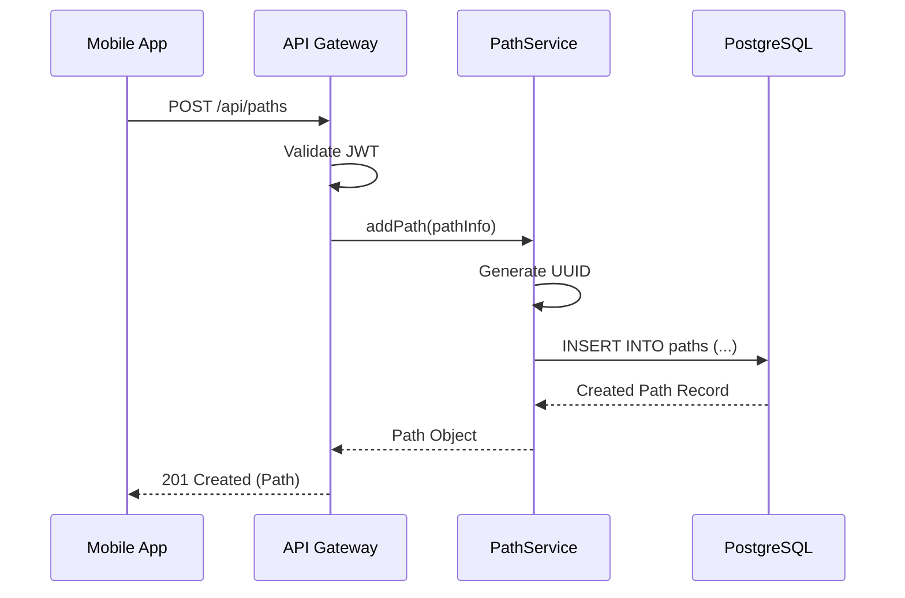
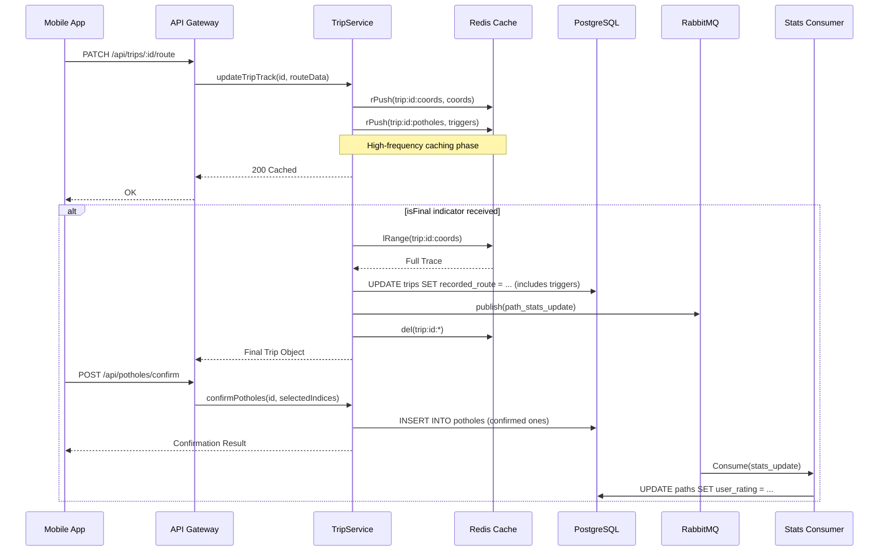
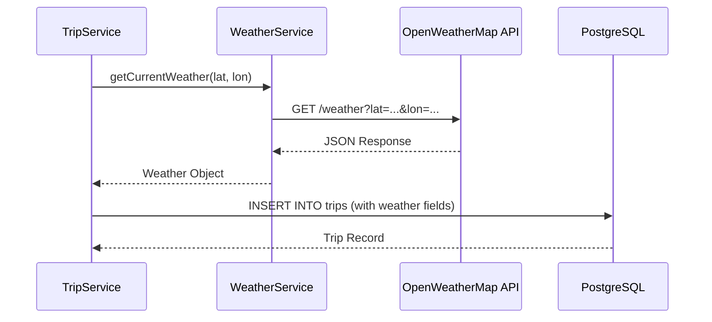

# Integration Flow Sequence Diagrams

This document contains Mermaid sequence diagrams for the integrated backend and infrastructure flows of Best Bike Paths (BBP).

## 1. Store Planned Path
This flow describes how a user saves a path including its pre-computed route data.

## 2. Live Trip Tracking (Optimized with Redis)
This flow shows the high-frequency coordinate recording using Redis lists to offload PostgreSQL.

## 3. Weather Data Accrual
Integration with external OpenWeatherMap API during trip start.

